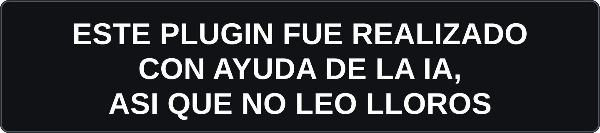
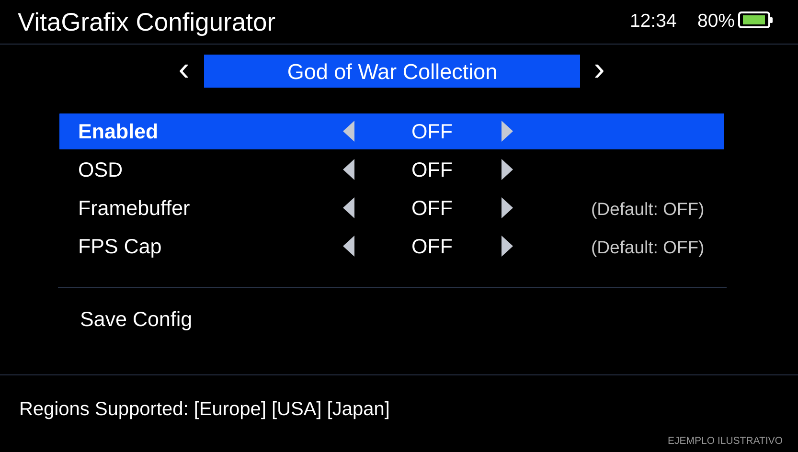

# GoW_PSD09V1 — God of War I para PS Vita

**GoW_PSD09 V1** es un complemento para God of War I en PS Vita que permite utilizar la resolución nativa y ajustar automáticamente el comportamiento de los FPS entre los menús y la partida.

> Compatible exclusivamente con **God of War I**, de **God of War Collection**, **EU v1.00 / PCSF00438**. No se ha verificado en otras regiones.


<p align="center">
  
</p>

## Características

- Resolución nativa **960 × 544**, sin VitaGrafix ni rePatch.
- **FPS desbloqueados y variables durante la partida**; no obliga al juego a funcionar a 60 FPS, solo quita el bloqueo de 30 fps que viene por defecto.
  

## Descargar e instalar

> ⚠️ **ADVERTENCIA:** Antes de instalar el plugin, si utilizas **VitaGrafix**, desactiva **Enabled** para **God of War Collection** y deja las opciones **Framebuffer** y **FPS Cap** en **OFF** para evitar posibles conflictos.




1. Necesitas una PS Vita con **HENkaku/taiHEN** y una copia compatible de God of War Collection, región europea **PCSF00438**, versión 1.00.
2. Guarda una copia de tu `ur0:tai/config.txt`.
3. Copia el archivo descargado `GoW_PSD09.suprx` a `ur0:tai/`.
4. En `ur0:tai/config.txt`, coloca una sola entrada bajo el identificador del juego:

```ini
*PCSF00438
ur0:tai/GoW_PSD09.suprx
```

5. Evita otros parches simultáneos de FPS o resolución para este juego. Reinicia la Vita y ejecuta God of War I.

## Comportamiento

| Estado | Resolución | FPS |
|---|---|---|
| Partida | 960×544 | Desbloqueados, variables |
| Menú principal | 960×544 | Aproximadamente 30 |
| START | 960×544 | Aproximadamente 30 |
| SELECT | 960×544 | Aproximadamente 30 |

El límite de los menús es intencional: las versiones experimentales que intentaron mostrar sus animaciones a 60 FPS provocaron aceleración o parpadeos. Esta edición conserva el comportamiento de la **v22, probado en una PS Vita real**.

## Reportes de errores y comentarios

¿Encontraste algún problema con el plugin o tienes una sugerencia?

- 💬 **[Dejar un comentario o consultar un error](https://github.com/Psdroid09/GoW_PSD09V1/issues/1)**: hilo abierto para compartir experiencias, dudas, capturas y videos.
- 🐞 **[Reportar un error por separado](https://github.com/Psdroid09/GoW_PSD09V1/issues/new?template=bug_report.yml)**: formulario para describir un fallo y darle seguimiento.

## Mi canal de YouTube

📺 **¡Apoya este proyecto!** Si te gustó el plugin, te invito a visitar y suscribirte a mi canal de YouTube: **[PsDroid09](https://www.youtube.com/@PsDroid09)**.

## Contribución

**Único autor del proyecto: [Psdroid09](https://github.com/Psdroid09).**

Este repositorio público distribuye solamente el plugin compilado; **el código fuente no se incluye**. No contiene archivos, datos ni recursos de God of War.
